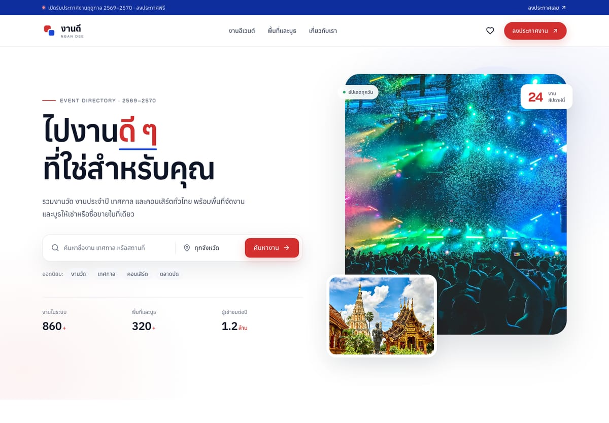

# งานดี · Ngan Dee

A modern, minimal event-discovery and space-marketplace website in Thai. Built with Vite + React.

**Live site:** https://ronnakit290.github.io/ngan-dee/



## What it is

งานดี (Ngan Dee) is a mock marketplace for Thai events and event spaces:

- **Discover events** — temple fairs, annual festivals, music festivals, concerts, night markets, expos, art shows and food festivals.
- **Find spaces** — white halls, studios, lawns, booths and warehouses for **rent** or **sale**.
- **Post an announcement** — a working mock form for events or spaces with client-side validation.
- **Save favourites** — persisted in `localStorage`.
- **Contact flow** — booking/enquiry modal with validation and a mock success reference.

All data is mock data in `src/data/`.

## Pages

| Route | Page |
| --- | --- |
| `/` | Home — hero, categories, featured events, space marketplace, upcoming calendar, testimonials |
| `/events` | Event directory with search, category, province, sort and saved filters |
| `/events/:slug` | Event detail — schedule, highlights, booths, map, booking modal |
| `/spaces` | Space marketplace with rent/sale toggle, search, type and province filters |
| `/spaces/:slug` | Space detail — facts, amenities, host, map, enquiry modal |
| `/post` | Post an event or space (mock submission with validation) |
| `/about` | About and contact |
| `*` | Custom 404 |

## Stack

- **Vite 6** + **React 19**
- **React Router 7** (browser router, base-path aware)
- **lucide-react** icons
- Plain CSS design system in `src/styles.css` — no UI framework
- Fonts: **Anuphan** + **Bai Jamjuree** (Google Fonts)

## Run locally

```bash
npm install
npm run dev
```

Build and preview production:

```bash
npm run build
npm run preview
```

The build also creates `dist/404.html` (a copy of the SPA shell) so deep links work on
GitHub Pages.

## Deploy to GitHub Pages

The included workflow (`.github/workflows/deploy.yml`) builds with
`VITE_BASE=/ngan-dee/` and deploys `dist` to GitHub Pages on every push to `main`.

1. Create a public repository named **`ngan-dee`**.
2. Push the project to `main`.
3. In **Settings → Pages**, set **Source** to **GitHub Actions** (or run the API call below).
4. The site appears at `https://<user>.github.io/ngan-dee/`.

```bash
gh api -X POST repos/<user>/ngan-dee/pages -f build_type=workflow
```

If you rename the repository, update `VITE_BASE` in the workflow and the base path
in the router follows automatically via `import.meta.env.BASE_URL`.

## Image credits

Photography is free-to-use stock from **Unsplash** (Unsplash License) and one image from
**Wikimedia Commons**.

The lantern-festival photo is:

- “Festival Yi Peng. ChiangMai, Tailandia. (16786888573)” by **Carlos Adampol Galindo**
  (DF, México), licensed **CC BY-SA 2.0**.
  [Source on Wikimedia Commons](https://commons.wikimedia.org/wiki/File:Festival_Yi_Peng._ChiangMai,_Tailandia._(16786888573).jpg)
  · [License](https://creativecommons.org/licenses/by-sa/2.0)

Other photos are from [Unsplash](https://unsplash.com) and are used under the
[Unsplash License](https://unsplash.com/license). See [docs/credits.md](docs/credits.md)
for the full photo-ID list. Images were resized and converted to WebP.

## Notes

This is a portfolio/demo site. Bookings, contact submissions and newsletter sign-ups are
mocked in the browser — no payment, database or email service is connected.
